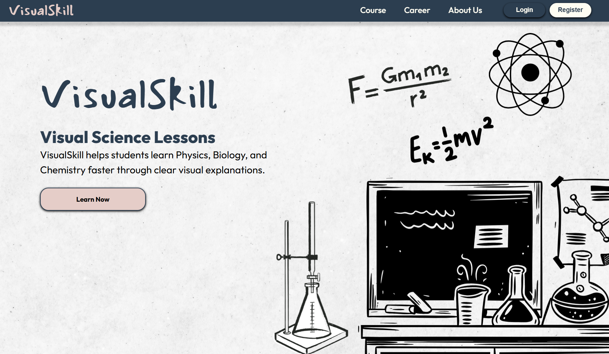

<p align="center">
  
</p>

# 🎓 SkillSkill - Online Learning & Career Platform Speciality in Science

**SkillSkill** adalah platform berbasis web statis yang dirancang untuk memfasilitasi pembelajaran daring (*e-learning*) dan pengembangan karir tentang Ilmu Pengetauan Alam. Website ini menyajikan antarmuka modern, responsif, dan interaktif yang memudahkan pengguna menjelajahi kelas keahlian serta mempersiapkan karir profesional.

---

## 🌐 Demo Langsung

👉 **[Kunjungi SkillSkill Website](https://satyavirya-a.github.io/SkillSkill-Project/)**

---

## 📌 Halaman & Fitur Utama

Website SkillSkill terdiri dari modul halaman yang terorganisir:

1. **Halaman Beranda (`index.html`)**
   * Hero section yang interaktif dengan *Call to Action* (CTA).
   * Sorotan program kursus unggulan.
   * Ringkasan nilai tambah dan keunggulan belajar di SkillSkill.

2. **Katalog Kursus (`HTML/course.html`)**
   * Daftar materi dan kursus peningkatan keterampilan (*upskilling*).
   * Tampilan kartu kursus (*course cards*) dengan tata letak rapi.

3. **Peluang Karir (`HTML/career.html`)**
   * Informasi program akselerasi karir dan lowongan magang/kerja bagi peserta.

4. **Tentang Kami (`HTML/about-us.html`)**
   * Profil singkat, visi, dan misi platform SkillSkill.
   * Nilai-nilai budaya dan dedikasi platform terhadap pendidikan teknologi.

5. **Autentikasi Pengguna (`HTML/login.html` & `HTML/register.html`)**
   * Antarmuka form masuk (*Login*) dan pendaftaran akun baru (*Register*) dengan desain yang konsisten.

---

## 📁 Struktur Direktori

```text
SkillSkill-Project/
├── Assets/                # Gambar, logo, ikon, dan aset grafis
├── CSS/                   # Berkas stylesheet untuk setiap halaman
│   ├── about-us.css
│   ├── career.css
│   ├── component.css      # Reusable UI styling (tombol, card, dsb.)
│   ├── course.css
│   ├── global.css         # Reset CSS, variabel warna, tipografi dasar
│   ├── homepage.css
│   ├── login.css
│   └── register.css
├── HTML/                  # Sub-halaman proyek
│   ├── about-us.html
│   ├── career.html
│   ├── course.html
│   ├── login.html
│   └── register.html
├── JS/                    # Berkas interaktivitas JavaScript untuk setiap halaman
│   ├── about-us.js
│   ├── career.js
│   ├── course.js
│   ├── global.js
│   └── register.js
├── index.html             # Titik masuk utama (Homepage di root)
└── README.md              # Dokumentasi proyek
```

---

## 🛠️ Teknologi

* **HTML5:** Struktur semantik halaman web.
* **CSS3:** Styling kustom, Flexbox/Grid, transisi, dan *media queries* untuk responsivitas multi-perangkat.
* **JavaScript (ES6):** Logika antarmuka interaktif dan manipulasi DOM.
* **GitHub Pages:** Layanan hosting dan continuous deployment statis.

---